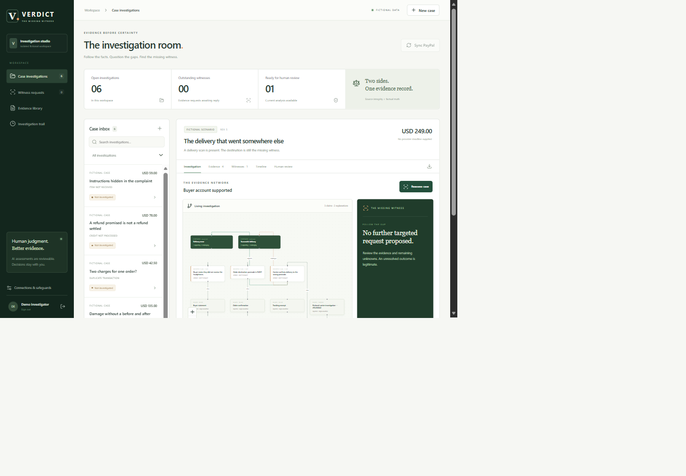
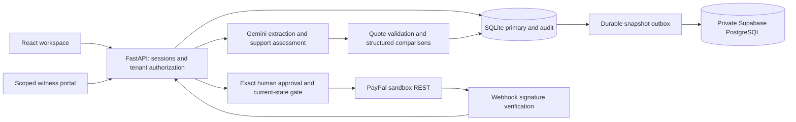

# VERDICT — The Missing Witness

[Public source](https://github.com/harshil0014/verdict-ai) · [Verified publication](docs/PUBLICATION.md)

**Don't automate the argument. Find the missing evidence.**

VERDICT investigates disputed payments by comparing competing accounts, identifying the next useful witness, acquiring a targeted response and updating a source-linked investigation. It assists human judgment; it does not decide who is telling the truth or predict dispute wins.

## Working build

React/React Flow interface + FastAPI backend + transactional SQLite persistence + optional private Supabase PostgreSQL snapshot mirror + real Gemini structured analysis + sandbox-only PayPal REST adapter.

- Case inbox, search, evidence library, source inspector, interactive claim/hypothesis graph, change-aware investigation and chronological integrity-checked audit record.
- Actual Gemini extraction and a separate semantic-support review. Exact quotation checks are mechanical. Structured field discrepancies are kept separate from semantic assessments. New evidence makes the previous analysis visibly stale.
- Targeted witness requests name what competing explanations they distinguish. Restricted one-response portals accept text or a document without exposing other evidence. Links are created locally; no email is sent automatically.
- TXT, JSON and text-bearing PDF ingestion with source/page references, stored originals, size/type limits and isolated PDF extraction. Scans/images/OCR are not supported yet.
- Human review and JSON case export. Sandbox action preparation binds exact payload, evidence, case revision, provider snapshot and expiry. Provider state is reread before an explicitly approved dispatch. Replay/unknown outcomes are blocked durably.
- Operator, isolated demo-workspace and scoped portal access boundaries. Real sandbox records are unavailable to demo users.

The browser-tested centerpiece began with a reception delivery scan and insufficient evidence. A restricted carrier response reported a different destination postcode. Real model reassessment changed the finding to buyer account supported and updated the graph and timeline. These records are explicitly fictional; they are not PayPal disputes.

## Application capture



Actual browser capture using fictional records and a real Gemini reassessment. The captured frame has extra whitespace and does not show the complete page. It is not a rendered product mockup. See [architecture and trust boundaries](docs/ARCHITECTURE.md) and [the complete verification status](docs/STATUS.md).

## Run locally on Windows

Python 3.13 and Node 22 were used. Existing local credentials in `backend/.env` are retained, ignored by Git and never included in a release.

```powershell
git clone https://github.com/harshil0014/verdict-ai.git
cd verdict-ai
python -m venv backend/.venv
backend/.venv/Scripts/python.exe -m pip install -r backend/requirements.lock.txt
cd frontend
npm.cmd ci
npm.cmd run build
cd ..
# For a fresh checkout only: copy backend/.env.example to backend/.env,
# then fill private credentials. Never overwrite an existing .env.
backend/.venv/Scripts/python.exe launch.py
```

If dependencies are already installed, double-click **Launch VERDICT.cmd**. The launcher starts a loopback-only server and opens a single-use local operator URL without printing it. Subsequent use relies on the browser session. Set a private `VERDICT_OPERATOR_PASSWORD` of at least 16 characters for password access. If the one-time token has been consumed and the browser session is gone, stop/restart the local server or use the configured operator password.

For a manual server, from `backend`:

```powershell
$env:VERDICT_LOCAL_BOOTSTRAP='true'
$env:VERDICT_SUPABASE_MIRROR='true'
.venv/Scripts/python.exe -m uvicorn app:app --host 127.0.0.1 --port 8000 --no-access-log
```

Open `http://127.0.0.1:8000/`. **Explore fictional cases** creates an isolated workspace. Hosted demos require an owner-provided judge access code; local exploration leaves it blank. No sample login grants access to the operator's sandbox data. Each demo workspace is limited to eight completed investigations. Model calls share local pacing below the observed 15 RPM limit; quota/transport failures remain visible instead of becoming fabricated results.

Linux setup uses `backend/.venv/bin/python` and the same requirements/build steps. Linux commands and the Docker image are prepared but were not executed on this Windows host.

## Environment and cloud storage

See [backend/.env.example](backend/.env.example). Credentials stay server-side. `GEMINI_MODEL` defaults to the successfully tested `gemini-3.1-flash-lite`. Model listings did not guarantee generation support: 2.5 names returned 404; 3.5 passed a tiny connection probe but failed larger runs, so it was replaced explicitly with the verified 3.1 model.

`VERDICT_SUPABASE_MIRROR=true` enables private operator-case snapshots through a durable outbox. Apply [the migration](supabase/migrations/001_private_snapshots.sql) in your own Supabase project. The existing user's project migration was applied and checked: RLS enabled/forced, no anonymous/authenticated SELECT grants, six snapshots written and read back successfully. [Verification record](docs/supabase-verification.json). The secret key never reaches React. Demo workspaces are not mirrored.

**SQLite remains primary.** Cloud snapshots include extracted evidence, case analysis and timeline, not raw attachments, sessions, portal-token tables or PayPal action reservations. Cloud restore is not implemented/certified. Local evidence files live in the SQLite database under ignored `runtime/`. Use private durable disk and a backup plan before operating provider writes.

## PayPal integration and limits

Actual OAuth and dispute listing returned **200**, with **zero disputes**. No available eligible sandbox dispute existed for detail retrieval or an evidence submission test. Code and mock-transport tests cover detail import, capture/order linkage, message/evidence/accept-claim preparation and dispatch, safe HATEOAS checking, duplicate reservation, signature verification and uncertain outcomes. These are **not** claimed as completed external lifecycle tests. See [the capability ledger and sandbox walkthrough](docs/PAYPAL.md). A genuine USD 1.00 sandbox checkout helper is documented in [SANDBOX_CHECKOUT.md](docs/SANDBOX_CHECKOUT.md); buyer approval is a real provider step and no completed transaction is invented.

`VERDICT_ALLOW_SANDBOX_ACTIONS=false` is the default. The UI cannot send a fictional/manual case to PayPal. Only an operator reviewing an imported sandbox dispute can prepare an action. Enable sandbox writes only after reviewing that operation and using durable primary storage. No live PayPal endpoints, automatic refunds, mass payouts or forced adjudication are exposed. Register a public HTTPS webhook and privately configure `PAYPAL_WEBHOOK_ID` to test deliveries; an unconfigured endpoint fails closed.

## AI design

1. Read a bounded case revision and its reported evidence.
2. Generate typed claims, competing hypotheses, unknowns and qualitative witness priorities with Gemini.
3. Reject nonexistent source IDs or quotations; prune their graph relationships.
4. Independently ask a model whether each original source entails its claimed meaning. This is a model judgment, not an independent factual verification.
5. Compare semantically assessed structured fields deterministically. Keep missing information unknown.
6. Persist the complete accepted analysis, input digest, usage, latency and case revision. Refuse to overwrite a newer revision.
7. Create a scoped request only through user interaction, ingest a response, mark the analysis stale and reassess with the same logic.

The model never receives a financial-action tool. Generated summaries/recommendations and hypothesis relationships can still be wrong; a human must inspect sources. Free-tier Google processing may use submitted data to improve products: the application requires explicit permission before analysis. Use only fictional or appropriately authorized evidence.

## Architecture



## Tests and evaluation

```powershell
backend/.venv/Scripts/python.exe -m pytest
backend/.venv/Scripts/python.exe evaluation/build_dataset.py
backend/.venv/Scripts/python.exe evaluation/run.py
```

The deterministic test suite checks authorization/tenant/file/portal boundaries, stale writes, source checks, unsafe upload rejection, audit modification detection, snapshot retry behavior, approval replay, changed evidence and webhook duplicate handling. External provider behavior is mocked in these tests; live probes are reported separately. A Starlette/httpx deprecation warning is recorded, not hidden.

The 30-case fictional development set covers delivery location/recipient ambiguity, damage, changed descriptions, product specifications, accessories, duplicate captures, authorization holds, currency displays, refunds, timestamps, wrong-order evidence, misleading documents, prompt injection and irreducible uncertainty. Labels and witness inventory are separate from model input. The harness compares ordinary initial review (A), checklist initial review (B), and VERDICT before/after a targeted witness. A matched-evidence B run tests whether new information alone explains improvement. All results are checkpointed; API failures are retained. [Evaluation methodology and results](docs/EVALUATION.md).

This is an authored development pilot, not a held-out real-case benchmark. Regex request/contradiction screens and model-assessed support require human validation. No real win rate, independent fraud accuracy or superiority over commercial products is inferred.

## Deployment and judge access

There is **no remote deployment yet**. The running localhost service is not described as deployed. The functional local build plus complete setup satisfies the official alternative to a hosted demo, subject to providing the required public repository and testing access. [Dockerfile](Dockerfile), [Render blueprint](render.yaml) and [deployment notes](docs/DEPLOYMENT.md) prepare a real host; public source publication has been authorized; no paid hosting activation is authorized. The cloud snapshot mirror is live and verified, but it is not application hosting.

## Attribution, originality and next work

[Research and prior-art review](docs/RESEARCH.md) records source files, tests, licenses and pinned commits of five close projects. No competitor application was copied. React Flow, React, FastAPI, Pydantic, httpx, pypdf and other maintained dependencies provide infrastructure; see [third-party notices](THIRD_PARTY_NOTICES.md) and lockfiles.

Our contribution is the integrated, source-inspectable hypothesis→targeted witness→reassessment workflow and its product experience. We do not claim to have invented evidence checklists, active information acquisition, citation verification or approval binding. Remaining priorities are a real eligible sandbox lifecycle test, complete hosted verification, stronger independent evaluation, OCR if needed, disaster-recovery validation and organization-level identity controls. Security/privacy limitations and operational boundaries are explicit in [SECURITY.md](docs/SECURITY.md). Submission text and a sub-three-minute script are prepared in [SUBMISSION.md](docs/SUBMISSION.md); no submission or YouTube publication has occurred.

MIT licensed. Do not include private credentials, customer data, runtime state or sandbox passwords when publishing.
