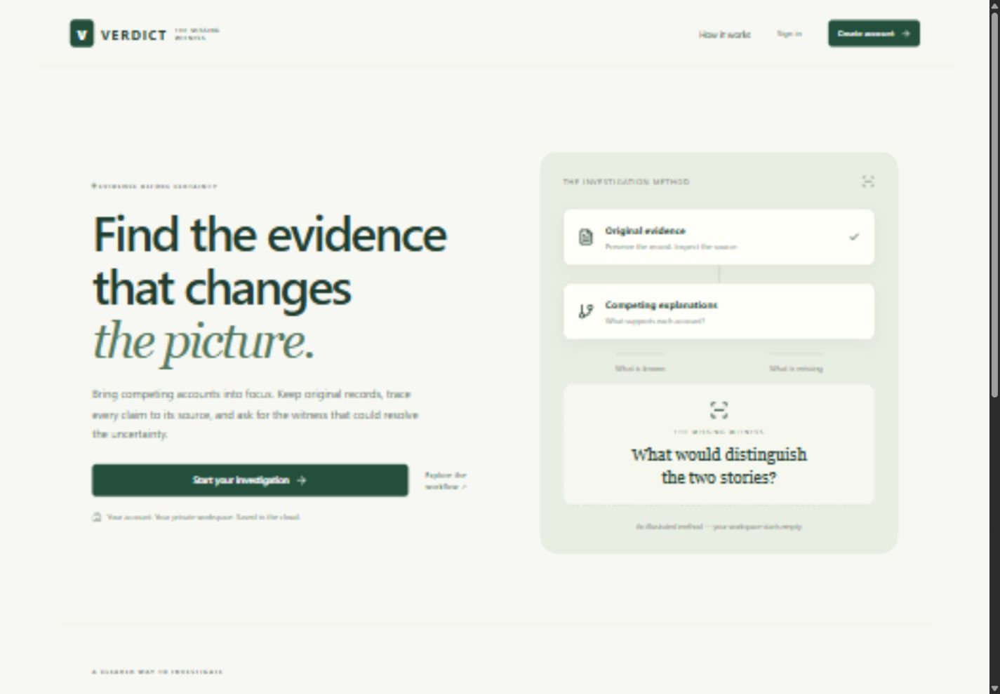
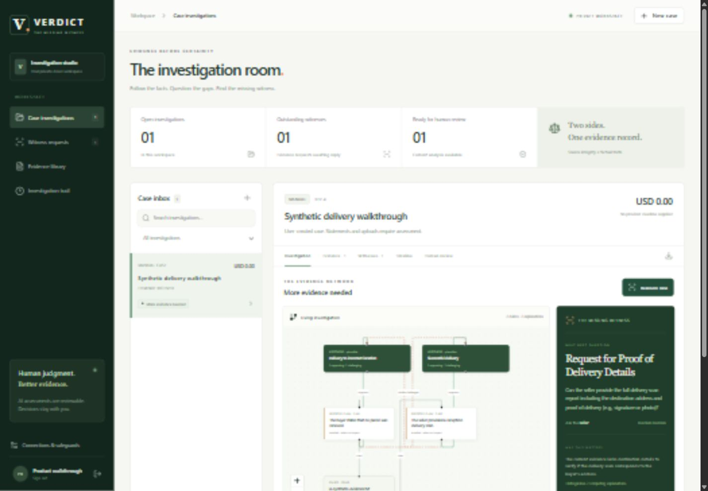

# VERDICT — The Missing Witness

**Find the evidence that changes the picture.**

VERDICT is a multi-user investigation workspace. Create a private case, preserve original records, compare competing accounts with Gemini, inspect the source graph and collect targeted witness responses. Human decisions stay with the investigator.

**Add the evidence. VERDICT investigates. You decide.** The [simplified product experience](docs/PRODUCT_EXPERIENCE.md) leads with a source-linked assessment and one useful next step. Maps, witness responses and reassessment run automatically where authorized; graphs and technical records stay available under details. Explicit map permission can be remembered across cases, and temporary interruptions use durable bounded recovery.

[Open VERDICT](https://verdict-ai-harshil0014.onrender.com) · [Source](https://github.com/harshil0014/verdict-ai) · [Architecture](docs/ARCHITECTURE.md) · [Security](docs/SECURITY.md) · [Setup and deployment](docs/DEPLOYMENT.md) · [Acceptance evidence](docs/SAAS_ACCEPTANCE.md)

## The account application

- Public username/password registration and sign-in, Argon2id password hashing, revocable opaque sessions and a one-time recovery key. No shared login, judge code or fictional case seeds.
- Cloud PostgreSQL is the **primary** store for accounts, sessions, cases, original file bytes, investigations, witness responses, tokens, jobs and audit records. Account mode has no SQLite fallback.
- Session-derived ownership and forced database row-level security isolate cases, files, requests, audits and jobs. No database secret reaches the browser.
- An empty private workspace with own-case onboarding. Upload TXT, JSON and text-bearing PDFs; inspect extracted content and download stored originals with SHA-256 integrity checks. Scans, OCR and images are not supported.
- Evidence submission starts a durable automatic investigation. VERDICT follows up to three safe literal public references, preserves actual HTML/PDF snapshots and refreshes the Gemini investigation without a separate approval or reassessment click. PDF hyperlink annotations are included. Review the graph, source passages, conclusions and consequential actions; pause automatic work per case when needed.
- [Original-publisher recovery](docs/SOURCE_RECOVERY.md) searches by a public neutral citation when a supported CanLII/BCCRT decision is inaccessible. Only actual publisher content with a matching indexed citation is adopted; the original refusal and provenance remain visible. Other courts and arbitrary document matching are not yet supported.
- Real Gemini extraction and separate semantic-support/classification review. Mechanical citation checks reject missing sources/quotations. Prior analysis remains visible while new evidence is investigated; failures preserve saved records and show a retryable status.
- Restricted seven-day, single-response witness links. Reply, original file, case state and audit event commit together. Links can be withdrawn or marked reported unavailable. No automatic email is sent; token possession does not verify identity.
- Revision checks, durable investigation leases, JSON export and an integrity-checked audit trail. Logout and recovery revoke cloud sessions.
- Public URL evidence and autonomous document discovery: official Google URL Context, free Tavily keyless search and Wikimedia/Crossref discovery preserve accessible original snapshots with permanent provenance. Collected sources remain unreviewed, not authenticated facts. Current pages never establish a past policy merely by being retrieved. [Automatic workflow](docs/AUTOMATIC_INVESTIGATION.md) · [Providers and controls](docs/PUBLIC_RESEARCH.md). Google paid Search grounding remains disabled.
- [Account-scoped PayPal sandbox import](docs/SAAS_PAYPAL.md) for an explicitly authorized test merchant: provider-populated private cases, preserved dispute/capture/order snapshots, payment linkage, separate payment/disputed amounts, automatic investigation and idempotent sync. Public merchant onboarding and provider actions remain disabled.
- [Smart Delivery Location Verification](docs/DELIVERY_LOCATION.md): automatic source-backed destination comparison, authorized real Photon/OSM geocoding, interactive Leaflet maps, explicit versus inferred PINs and precision-aware outcomes. External lookup defaults off; one-time per-case permission supports subsequent automatic evidence processing. Map estimates do not prove delivery.

Free beta limits: 50 cases, 20 MB of originals and 10 investigation attempts/account/day; 5 MB/file and 40 sources/case. Shared capacity limits can refuse new work while retaining existing data. Free compute may sleep. This is a functioning beta, not an uptime, accuracy or disaster-recovery certification.

## Local setup

Python 3.13 and Node 22 are used in CI. Apply the timestamped SaaS migrations in `supabase/migrations` in filename order to your own Supabase project. The earlier `001_private_snapshots.sql` is only for the optional legacy mirror.

```powershell
git clone https://github.com/harshil0014/verdict-ai.git
cd verdict-ai
python -m venv backend/.venv
backend/.venv/Scripts/python.exe -m pip install -r backend/requirements.lock.txt
cd frontend
npm.cmd ci
npm.cmd run build
cd ..
# Fresh checkout only: copy backend/.env.example to backend/.env.
# Set SUPABASE_URL, SUPABASE_SECRET_KEY, GEMINI_API_KEY and a random
# VERDICT_AUTH_PEPPER with at least 24 characters. Never commit secrets.
cd backend
.venv/Scripts/python.exe -m uvicorn saas_app:app --host 127.0.0.1 --port 8000 --no-access-log
```

Open `http://127.0.0.1:8000/`, register and save your recovery key in a password manager. No email is collected; there is no email reset or claim of verified email ownership. On HTTPS set `VERDICT_SECURE_COOKIES=true` and `VERDICT_PUBLIC_HOST` to the exact hostname. Never overwrite existing private credentials.

```powershell
backend/.venv/Scripts/python.exe -m pytest
backend/.venv/Scripts/python.exe scripts/saas_acceptance.py --base http://127.0.0.1:8000 --phase prepare
# Restart the SaaS application, then:
backend/.venv/Scripts/python.exe scripts/saas_acceptance.py --base http://127.0.0.1:8000 --phase verify
```

The acceptance runner registers two independent accounts normally, uploads synthetic evidence, calls real Gemini and tests witness replies, isolation and logout. Credentials stay in ignored runtime state. `--base` targets a deployed instance sharing the same primary database; verify compares original bytes, analysis digest, witness state and audit hashes after restart/deploy. [Exact results and limitations](docs/SAAS_ACCEPTANCE.md). Two automated actors do not mean two humans completed usability testing.

For public evidence, submit a document containing its public references. Retrieval, preservation and investigation happen automatically. **Evidence** shows uploads and discovered sources together, including URLs, hashes and review status. **Investigation** and **Timeline** retain progress, failures and provider reports. The optional **Find more evidence** action accepts another URL or public search question without adding another case tab. Search needs no provider account/card/key; shared throttling can limit discovery. Optional Google URL Context uses the existing Gemini key. The [automatic Moffatt acceptance runner](scripts/automatic_investigation_acceptance.py) makes no analyze, approval, search or retry calls. [Behavior, recovery and limits](docs/AUTOMATIC_INVESTIGATION.md).

## Preserved sandbox integration

The separate `app:app` operator build retains the PayPal sandbox adapter, read-only capture/order acquisition, local launcher and fictional exploration. It does not share account workspaces. Docker selects account mode with `VERDICT_APP_MODULE=saas_app:app`; its compatibility default remains `app:app` so the previous release is recoverable.

An actual USD 1.00 sandbox order was approved and captured once; its buyer-created inquiry was imported with verified payment linkage. Unchanged snapshots deduplicate and changed snapshots preserve history. Two individually approved notes submissions were rejected with `EVIDENCE_TYPE_IS_NOT_ALLOWED`; successful submission remains unverified. No fulfillment evidence was invented. [Capability ledger](docs/PAYPAL.md) · [Acquisition](docs/PAYMENT_ACQUISITION.md).

**Only the explicitly authorized first-party test merchant can use the account-connected sandbox integration.** Public merchant onboarding and financial actions are not enabled. No live merchant capability, automatic refund or delivery verification is claimed. The legacy release branch and private configuration remain recoverable. [Authorization and privacy boundaries](docs/SAAS_PAYPAL.md).

## Evaluation and capture

The frozen authored 30-case pilot tied the checklist baseline at **28/30**. The custody set also tied. These small synthetic evaluations do not establish superiority or real dispute outcomes. [Evaluation](docs/EVALUATION.md) · [Custody evaluation](docs/CUSTODY_EVALUATION.md).





Actual browser captures of the account application. The investigation uses explicitly synthetic user-authored evidence and real Gemini calls. [Mobile landing](docs/screenshots/account-landing-mobile.jpg) · [Earlier operator capture](docs/screenshots/fictional-investigation.png). Browser checks and remaining acceptance phases are recorded in the ledger.

## License

Original code is MIT. Dependencies retain their licenses and notices in [THIRD_PARTY_NOTICES.md](THIRD_PARTY_NOTICES.md) and `third_party/`. Gemini, PayPal and Supabase services have separate terms. Read the [security limits](docs/SECURITY.md) before using sensitive records.

Automatic address recovery: [implementation and real API verification](docs/GEOCODING_RECOVERY.md). Approximate campus or transit-stop matches retain their accuracy labels and original addresses; no PIN is required in address mode.
