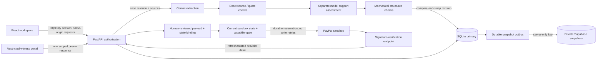
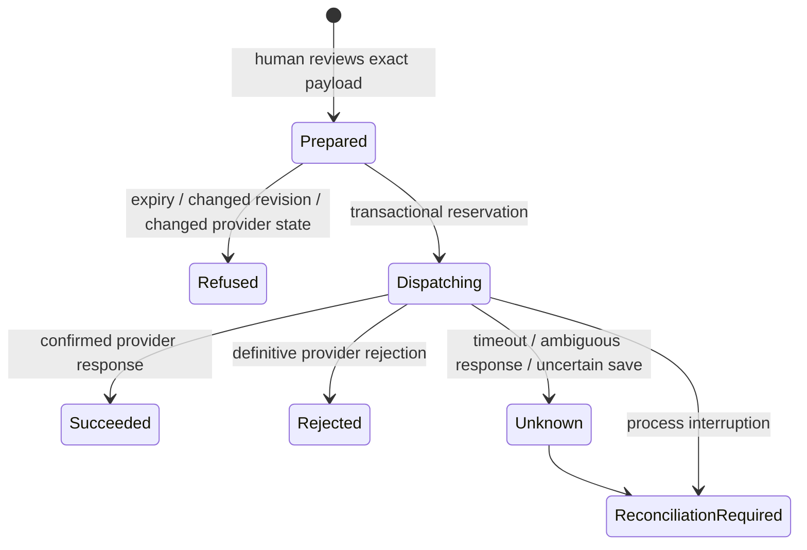

# VERDICT architecture and trust boundaries

This document describes the functioning single-instance application, not a proposed agent swarm. It is a sandbox investigation assistant. Real financial outcomes and external source truth are outside its authority.

## Runtime and module map

| Component | Implementation | Responsibility |
|---|---|---|
| Workspace and witness portal | `frontend/src/main.tsx`, React | Real API-driven case inbox, graph, source inspection, request review, portal response, timeline and exact-action review |
| Evidence graph | React Flow | Evidence→claim citations; semantically assessed claim→hypothesis supporting/challenging edges; node selection opens the source |
| HTTP boundary | `backend/app.py`, FastAPI | Sessions, tenant scope, consent, upload limits, optimistic revisions, witness capability tokens and operator-only provider endpoints |
| Structured contracts | `backend/domain.py`, Pydantic | Bound extraction/review/action input; reject unexpected or invalid structured model output |
| Investigator | `backend/investigator.py` | Bounded Gemini extraction and separate semantic-support assessment; quote validation, pruning, uncertainty and observable usage |
| Mechanical factual checks | `backend/structured.py` | Values present in quotes, explicit timezone normalization, Decimal amounts, conservative comparable fields |
| Transactional primary | `backend/store.py`, SQLite WAL | Cases, sessions, scoped requests, originals, approvals, webhook reservations, audit and cloud outbox |
| Optional cloud mirror | `backend/cloud.py`, Supabase REST | Retryable private operator-case snapshots, without exposing a privileged key to the browser |
| Provider adapter | `backend/paypal.py`, httpx | Sandbox-only OAuth, safe pagination, detail retrieval, documented actions, signature verification and conservative uncertainty |
| PDF parser | `backend/parse_pdf.py`, pypdf | Disposable bounded subprocess; page-text provenance; no OCR, active rendering or malware-scanning claim |
| Evaluation | `evaluation/` | Separate authored inputs/labels, checkpointed baselines, simulated witness inventory, matched-evidence control and frozen outputs |

## Investigation lifecycle

1. A case stores its mode (`synthetic`, `manual`, or `paypal_sandbox`) and an immutable-by-interface collection of original sources. Upload origin is reported, not authenticated. Provider-origin JSON is labeled separately.
2. The operator explicitly permits this evidence to be sent to Gemini. The model sees case data and source text as untrusted content; it receives no financial tools.
3. A typed extraction returns cited reported claims, competing hypotheses, unknowns, a recommendation and qualitative witness priorities. It does not compute calibrated probabilities or Bayesian information gain.
4. Mechanical quotation checks reject unknown sources, fabricated quotations and duplicate claim IDs. Unsupported graph references are removed.
5. A second model call assesses whether the original source entails each claim. This verifies meaning only as a fallible model judgment; it cannot prove a source is truthful. Non-entailed claims do not support hypothesis edges.
6. Structured values must occur in quoted material to participate in comparisons. Dates need explicit timezones; amounts need currency context. Model-extracted entity/field alignment remains subject to human review.
7. A compare-and-swap write accepts the result only if its input revision is still current. Older analyses survive in the audit timeline. Summaries and recommendations are not independently certified.
8. A human reviews and may correct the proposed question and recipient. The server creates a seven-day, one-response capability link. No email, carrier API call or notification is performed.
9. The portal exposes only that request. The intended party comes from the server record, not a submitter-controlled field. Possession of the link does not authenticate a respondent's identity.
10. New evidence is persisted atomically with request completion and makes prior analysis stale. Reassessment runs the same investigator and records the before/after finding. An unresolved result is valid.

## Consequential action lifecycle

Only an operator and an imported `paypal_sandbox` case can enter this path. Sandbox writes default off. Synthetic/manual records cannot be relabeled into actionable provider cases by the model.

The approval binds action, payload, approver, case revision, evidence digest, complete provider-state digest and ten-minute expiry. Execution rereads PayPal and checks its current HTTPS sandbox HATEOAS action link. A database reservation prevents overlapping dispatch; duplicates and unresolved outcomes are blocked. Provider checks cannot make a remote transaction atomic with the local database: PayPal can change state after the check and remains the final authority. No automatic payment/dispute write retry is used.

## Identity, privacy and deployment scope

- Eight-hour server sessions use opaque random cookies, HttpOnly and SameSite Strict. HTTPS hosts must enable Secure cookies. Local bootstrap tokens are single-use and loopback-only.
- Demo tenants are isolated from each other and from operator sandbox records. Public-host demo entry requires a separate judge code. Operator passwords, provider credentials and invitation/session tokens are never published.
- Private Supabase snapshots deny anonymous and ordinary authenticated table access; the server credential is privileged. Row-level security is defense in depth, not a substitute for application authorization. The primary database contains the authoritative request/action reservations.
- SQLite and raw originals require private durable disk. The optional mirror includes extracted case/analysis/audit snapshots; it does not back up all operational tables or provide a tested restore path. An ephemeral hosting instance must keep provider writes disabled.
- Hash-linked audit records detect internal modification but are not externally anchored or tamper-proof against a privileged host owner. Hashes prove neither factual truth nor source independence.
- The current product is single-instance. Organization membership, MFA/SSO, distributed locks, comprehensive privacy redaction, malware scanning and audited disaster recovery are future work.

See [security limitations](SECURITY.md), [provider capability evidence](PAYPAL.md), [research and attribution](RESEARCH.md), and [actual evaluation results](EVALUATION.md). The release contains real backend behavior and tests; fictional fixtures supply data, not scripted model conversations.
