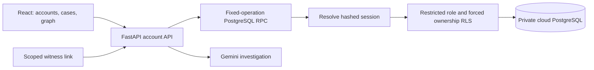

# Architecture

The [document-reading and sandbox-agent extension](AUTONOMOUS_RESOLUTION.md) adds bounded offline extraction before the existing durable research/investigation queue, optional consented Gemini page reading, and a separate server-only policy/action ledger. Financial eligibility does not come from the language model. Existing originals and cases remain in the same tenant-isolated cloud store. No paid queue or storage tier is added.

`backend/saas_app.py` is the account application. React calls same-origin FastAPI with an HttpOnly cookie. Only FastAPI has the cloud secret and Gemini key. `saas_auth.py` uses maintained pwdlib/argon2-cffi, not a custom password algorithm.

## Ownership and authentication

Registration atomically creates an account/session. Passwords use Argon2id; only SHA-256 hashes of random session/recovery tokens are stored. Sessions last 30 days; recovery rotates the key and revokes all prior sessions. Usernames avoid simulating verified email when public email delivery is unconfigured.

The fixed-operation `public.verdict_saas_api` is SECURITY INVOKER with EXECUTE only for the server service role. After resolving an active session it sets a transaction-local actor and drops privileges to `verdict_saas_executor` (NOLOGIN, NOBYPASSRLS). Forced RLS compares row ownership with that actor for cases/files/requests/audit/jobs. The client cannot supply its owner. The private schema is not exposed in PostgREST and ordinary roles lack grants/RPC execution.

Server secret compromise or a privileged administrator remains outside this ownership boundary. Authentication operations use the privileged server role; that key never reaches React. Shared pacing/quota metadata has separate restricted policies.

## Atomic persistence

Cases are revisioned JSONB; audit events are separate append-only rows. A row lock and expected revision reject stale updates. Case, original bytes, request completion and hash-linked event commit in one transaction; validation errors raise and roll back all changes. Downloads recompute SHA-256. Audit continuity proves internal consistency, not evidence truth or resistance to a privileged administrator.

Originals use cloud PostgreSQL bytea, bounded to 5 MB/file and 20 MB/account. This avoids split case/object-store commits in the free beta. Scaling requires a private object store with a reviewed finalization protocol, retention and backup plan. No account state depends on ephemeral Render files or SQLite.

## Investigations and witnesses

The existing engine retains typed Gemini extraction, separate support review, citation checks, comparisons and graph pruning. Consent gates transmission. A durable 15-minute job lease plus case revision prevents stale results replacing current work. Failures retain prior analysis. Database-backed shared pacing replaces legacy local model pacing; failed attempts count toward daily caps.

Witness tokens are random, hashed in storage, expire after seven days and permit one response. Only the question is exposed. Recipient binding comes from the stored request, not reply JSON. Reply/original/revision/audit completion is atomic. Bearer possession does not verify respondent identity.

## Public research boundary

The newer automatic workflow is implemented in `automatic_investigation.py` and `case_investigation.py`. A transactional case trigger writes a forced-RLS PostgreSQL workflow outbox. The existing web process claims a renewable lease, extracts literal text/PDF-annotation references, applies bounded safe retrieval and atomic snapshot adoption, then calls the shared leased investigation engine. No additional paid worker/queue service is provisioned. The frontend polls persisted progress; source collection is marked unreviewed, and users can pause a case. [Current automatic flow and recovery limits](AUTOMATIC_INVESTIGATION.md). The following paragraphs describe the original research implementation; manual staging remains an optional API mode.

`research_routes.py` separates public research proposals from official case evidence. `free_search.py` uses documented Tavily keyless and Wikimedia/Crossref APIs; no API key, credit card, scraped SERP or paid fallback. `google_research.py` uses the official Gen AI SDK for consented URL Context. Google's paid 3.x Search grounding is disabled after both free 2.5 options returned 404. Provider summaries stay research-only.

`public_web.py` performs a bounded single-document fetch, validates all resolved addresses/redirects and pins the actual network destination while preserving TLS SNI. `extract_public.py` runs offline Trafilatura/pypdf extraction. Cloud research drafts have forced ownership RLS; approval uses the existing atomic case/file/audit transaction, binds exact snapshot/text hashes and marks the analysis stale. Search snippets and inaccessible documents cannot be approved. [Detailed provenance and provider selection](PUBLIC_RESEARCH.md).

`source_recovery.py` adds a conservative BCCRT neutral-citation adapter. After a failed CanLII reference, the worker searches a public identifier through the existing free APIs, stages original-publisher candidates, and checks the exact indexed citation in real retrieved reasons before adoption. One literal same-document publisher iframe may be followed from a retained wrapper. Original failures and wrapper bytes remain private records, linked to the recovered source's integrity metadata and audit event. Worker-version requirements protect new jobs during mixed-version deployments. [Identity rules and verified scope](SOURCE_RECOVERY.md).

## Legacy boundary

`saas_paypal.py` reuses the sandbox adapter and `payment_records.py` through session-authorized, read-only routes. Forced-RLS connections bind the owned test-merchant credential reference to one account; import links and unique provider snapshots live in the same cloud database. A service-only RPC atomically commits case/audit, original JSON and the investigation outbox. The frontend/AI sees a minimized projection; full originals are not exposed through normal case or file APIs. The existing manual/evidence/witness/research paths are preserved. [Integration scope and setup](SAAS_PAYPAL.md).

`backend/app.py` remains a separate SQLite operator application with the optional snapshot mirror, fictional exploration and sandbox PayPal. It does not read account tables. Docker's module switch and the preserved legacy branch/service keep the working release recoverable. Cloud schema changes do not overwrite old data. See [deployment](DEPLOYMENT.md).
